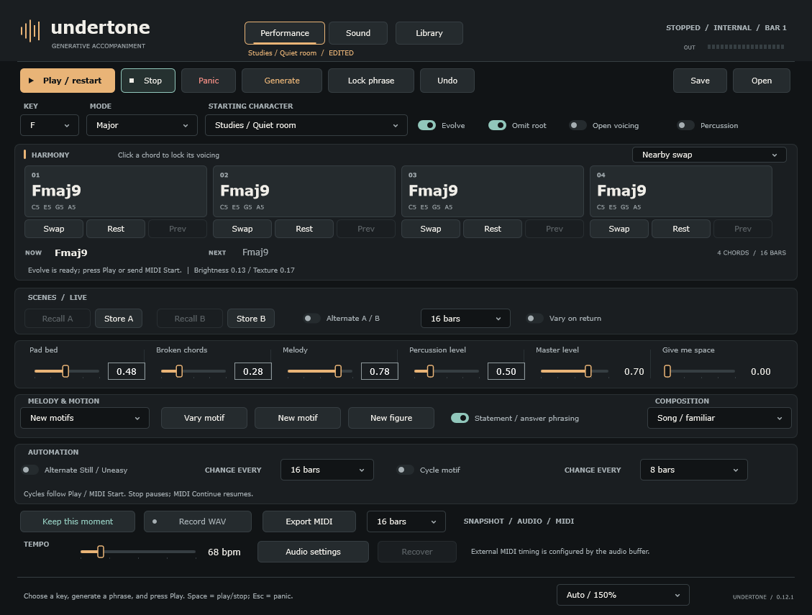

**Undertone — generative chords and pads**

Native software prototype v0.12.1 · November 1, 2026 · Owner: Mike

A personal instrument that generates chords and pads for bass practice, jams with Elektron beats, and darker electronic composition. The first Windows application is implemented and locally tested. macOS uses the same C++/JUCE source. The initial GitHub CI run built its universal package and passed native and Rosetta tests; interactive Mac audio/UI verification is still pending.

- [Quick start](docs/quick-start.md): run the app, generate harmony, save a session, and connect MIDI clock.
- [Sound and evolution changes](docs/sound-design-0.2.md): independent Ladder, DCO and FM tones, audible Evolve, legacy session migration, and architecture references.
- [Arrangement and phone auditions](docs/arrangement-0.3.md): recurring melodies, broken chords, sixteen-bar form, drift and filtered echo.
- [Optional percussion](docs/percussion-0.4.md): a steady pulse with seeded offbeats and short glitch accents, plus new MP3 auditions.
- [Melody phrasing and voices](docs/melody-0.5.md): harmony lookahead, controlled resolutions and four independent melody timbres.
- [Studies: composition and texture](docs/composition-0.6.md): Still/Uneasy generation, sparse gestures, 32-bar development, Felt object and Bowed wire voices.
- [Chord edits and automatic cycles](docs/cycles-0.7.md): per-slot Swap and Rest / Restore, with separate bar-synced composition and motif changes.
- [Performance, phrasing and capture](docs/performance-0.8.md): Hold/Vary/New, A/B scenes, deliberate swaps, compact controls, louder percussion, snapshots, WAV recording and MIDI export.
- [Studio interface](docs/ui-0.9.md): visual direction, native control polish and remaining product-design work.
- [Focused Sound editor](docs/sound-editor-0.10.md): six compact sections, engine-aware controls and shared Performance settings.
- [Preset and session library](docs/library-0.11.md): search, saved variations, recent files and edited-state protection.
- [Display scaling and refreshed presets](docs/presets-and-scale-0.12.md): automatic interface size, Lyrical/Pocket arrangements and a revised starting bank.
- [Build status](docs/build-status.md): verified behavior, known limitations, and the remaining PRD release gates.
- [Third-party dependency](docs/third-party.md): pinned JUCE source and distribution notes.
- [Apple silicon verification](docs/mac-verification.md): run the prepared Mac build and collect actual test/launch evidence.

- [Software PRD](docs/software-prd.md): Windows/macOS standalone MVP, musical behavior, interface, integration, and release criteria.
- [Hardware PRD](docs/hardware-prd.md): equivalent desktop instrument, physical requirements, build approaches, and learning milestones.

Confirmed requirements: software first; Windows and Mac support; generative chords/pads; room for a live bass player; integration with Digitone II, Digitakt I, and Syntakt. Musical interests include ambient, neo-soul, funk, and the slower dark ambient side of later Nine Inch Nails. Apple silicon is the available Mac test target; interactive Mac verification is still pending.

The musical core is plain C++17. The native application uses JUCE 9.0.4, pinned to commit `3fb5cbc0340758596dac39f7c8de47d562b4896e`. No network service is used at runtime. Hardware component selection and spending remain open for a later discussion.

**Repository.** [michaelbuckner/undertone](https://github.com/michaelbuckner/undertone) is the private source repository. `main` tracks the current prototype. Generated builds, exports, local settings and the vendored dependency checkout are excluded.

**Build on Windows.** Install CMake 3.22+ and Visual Studio C++ Build Tools with a Windows SDK. Run `./scripts/build-windows.ps1` in PowerShell. The executable is `build/Undertone_artefacts/Release/Undertone.exe`. The script discovers the Visual Studio-bundled CMake when it is not on PATH. This is a native Windows build, not WSL.

**Build on macOS.** Install Xcode Command Line Tools and CMake 3.22+, then run `bash scripts/build-macos.sh`. This requests a universal Intel/Apple silicon application with macOS 14 as its minimum target. The script has not yet been run on a Mac. The output path is `build-macos/Undertone_artefacts/Release/Undertone.app`.

Both builds fetch the pinned JUCE commit when `vendor/JUCE` is absent. An initial internet connection is needed to obtain this build dependency; the finished application runs offline.

**Build the portable engine only.** Run `cmake -S . -B build-core -DUNDERTONE_APP=OFF`, then `cmake --build build-core --config Release` and `ctest --test-dir build-core -C Release --output-on-failure`. This does not need JUCE. `render_demo` creates a WAV from the exact synth engine used by the app; arguments are output path, preset index 0–7, duration in seconds, optional tone index 0–8, and optional Evolve override 0/1 (sets Variation to 0.65 and interval to two bars). `soak_test 120 1` accelerates two minutes of dense chords on the Ladder engine; model IDs 0–3 select Warm/Ladder/DCO/FM.

**Package.** After a full Release build, run `cmake --install build --config Release --prefix dist/Undertone`. Windows packaging includes the required Microsoft runtime DLLs. The package is an unsigned local prototype; no installer, signing, or notarization is configured yet. The GitHub Actions workflow builds Windows/macOS and uploads test-build packages. Check the [Actions page](https://github.com/michaelbuckner/undertone/actions) for the current result; CI does not replace physical audio/MIDI verification.

**Source map.** `src/core/Music.*` contains scales, seeded generation, and voicing. `src/core/Engine.*` owns transport, queued edits, 16 voices, and effects. `src/core/MidiTimeline.*` maps incoming timestamps to audio samples through a bounded queue. `src/app` contains the native UI, audio/MIDI device adapters, and versioned session files. `tests` exercises the core, serialization, MIDI timing, rendering, and stress processing. No hardware-specific code is present.
